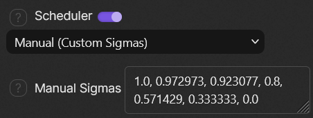
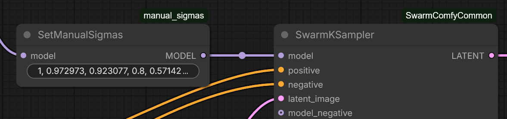

# SwarmUI Manual Sigmas

Adds a `Manual` scheduler to SwarmUI that samples with a list of sigmas you type in.

## Usage

1. In **Sampling**, set **Scheduler** to `Manual (Custom Sigmas)`.
2. Enter your list in **Manual Sigmas**, eg `1, 0.75, 0.5, 0.25, 0`.
3. Ensure **Steps** match the number of sigmas minus one.



Separate values with commas or spaces, and use `.` for decimals. The list normally ends with `0`. If the sigma count doesn't match Steps, generation stops with an error.

The **Refiner Scheduler** can also be set to `Manual`, with its own list in **Refiner Manual Sigmas**. That list needs one more sigma than **Refiner Steps** (or Steps if unset). If it is empty, **Manual Sigmas** is used.

### Per section

The sigma list can be set for one section only, through the prompt:

```
<video><param[scheduler]:manual><param[manualsigmas]:1, 0.8, 0.5, 0.2, 0><param[steps]:4>
```

This works with `<base>`, `<refiner>`, `<video>` and `<videoswap>`. A section without its own list uses the global one.

## How it works

- A small ComfyUI file registers `manual` as a scheduler. `SwarmKSampler` and the other samplers accept it unchanged, so variation seed, tiling, previews and other sampler features keep working.
- The `SetManualSigmas` node attaches the list to the model, and the scheduler reads it back at sampling time.
- SwarmUI adds this node to each model whose section uses `manual`.



## Limitations

- `<segment>` and regional prompts use the base model, so they get the base sigma list.
- If the video swap model is the same as the video model, the swap uses the video sigma list.
- **Manual Sigmas** only shows when Scheduler is `Manual`, and **Refiner Manual Sigmas** only when Refiner Scheduler is `Manual`. For other sections, set the list in the prompt.
